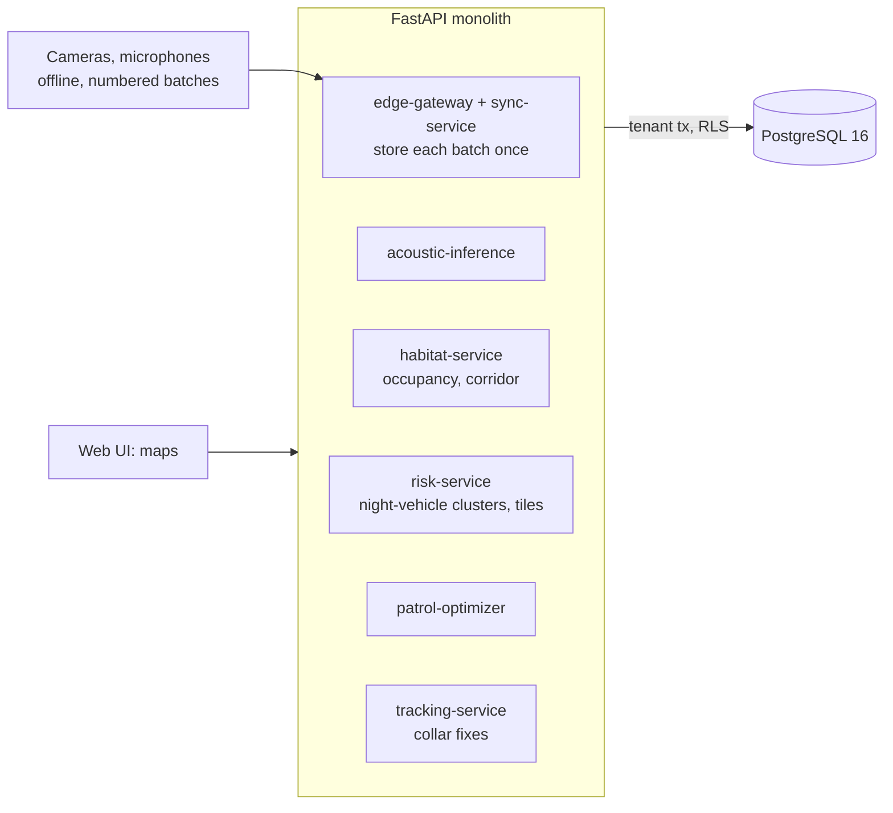

# Wildlife Conservation Intelligence Network

A reserve's camera traps, microphones and GPS collars in one place: it takes numbered uploads from sensors that are offline most
of the time, estimates which sites each species uses, tests whether a herd has changed its route, separates a real pattern of
night-time vehicles from stray mislabels, and proposes ranger patrols over a risk map.

Built from blueprint 6 of "Advanced Project Blueprints, Volume II" as a **vertical slice**: the demo scenario end to end, with the
platform parts real and the rest listed under [Not built](#not-built-and-why).

**The reserve and everything in it are simulated. There are no photographs or recordings: a camera detection is a label with a confidence, a sound is five summary numbers. Alerts and patrol plans are proposals for people to judge.**

## Run it

```bash
docker compose up --build        # migrates, trains the sound classifier, serves http://localhost:8206/ui/ with one worker
docker compose run --rm test     # 28 tests against a throwaway database
```

Open http://localhost:8206/ui/ and press **Run all steps**, or `make bootstrap demo`. API docs at `/docs`.
Demo tokens (local only): `reserve-warden-demo`, `reserve-ranger-demo`, `reserve-researcher-demo`. Run `make reset` before a second demo run.

## The demo, step by step

1. A month of uploads from 60 cameras and 16 microphones: 2,356 batches arrive, 76 of them duplicates (stored once), 95 out of order; one camera delivers five days late. 5,943 observations, no gaps left.
2. Leopards truly use 23% of camera sites. Trusting every label says 82%. Counting only labels at confidence 0.9 says 15% (too low: leopards are caught about one day in twenty-five). The occupancy model says 31% (range 16% to 59%).
3. After a block of habitat is cleared on day 15, elephant detections move from 7.6 to 14.2 km east: a 6.6 km shift, permutation p = 0.0002, confirmed by eight GPS collars (6.6 km).
4. Night vehicles: 45 night-time "vehicle" labels at 23 cameras, 13 of them confident. One cluster is raised: three cameras on the south-east boundary track on six nights, with engine sounds on five of those nights and a gunshot alert on one.
5. A risk map, and routes for three ranger teams covering 97% of the mapped risk in eight hours each; a fixed boundary patrol covers 81%.
6. A microphone resends a batch: nothing is stored twice. A loud, short crack is classified as a branch with a 10.5% gunshot probability; an alert needs 93.5%.
7. Against what the simulator planted: the vehicle cluster matches (five of six nights plus one stray), 2 of 3 gunshots raised alerts, the corridor matches. Then the audit log.

## Architecture



| Piece | How it works |
|---|---|
| Sync | A batch is identified by (sensor, sequence number) and inserted with `ON CONFLICT DO NOTHING`: resends and out-of-order arrivals are harmless, and the reply lists the batch numbers still missing. |
| Site use | Single-season occupancy model (maximum likelihood): a site with no detections is either unused, or used and missed every day. Fitted on detections at confidence 0.9 or more, with a bootstrap range. |
| Corridor shift | Difference in mean east-west position of confident detections before and after, with a 4,000-shuffle permutation test; cross-checked against collar fixes. |
| Sounds | Multinomial logistic regression on five log features. The gunshot alert threshold is set for the field, not the test set: precision is recomputed at an assumed prevalence of one gunshot per thousand sounds. |
| Night vehicles | A camera is flagged for confident night-time vehicles on at least two nights when a Poisson tail against the reserve-wide rate is under 0.001. Flagged cameras within 2.5 km form a cluster, joined by neighbours that saw it too, and cross-checked against engine and gunshot sounds within 4 km on the same nights. |
| Risk tiles | 0.5 x vehicle clusters + 0.3 x gunshot alerts + 0.2 x herd near the boundary, on a 1 km grid. The weights are a stated judgement. |
| Patrols | Prize-collecting vehicle routing (OR-Tools): skipping a waypoint costs its share of risk; each team must be back within its hours. |
| Platform | Row-level security per reserve, Postgres job queue, Idempotency-Key replay, hash-chained audit log, `/metrics`. |

## Data model

`migrations/002_reserve.sql` follows the blueprint (sensors, observations, animals, tracks, patrol_events); additions are marked
`(+)`: species, `sync_batches`, and the label, sound and batch columns on observations. Positions are kilometres on the reserve grid.

## API

| Method | Endpoint | Purpose |
|---|---|---|
| POST | `/v1/sensors/{id}/sync` | Upload one numbered batch; stored once |
| POST | `/v1/media/infer` | Classify a sound; would it raise a gunshot alert, and why the threshold is strict |
| GET | `/v1/species/{id}/distribution` | Site use before and after, three ways of counting |
| GET | `/v1/animals/{id}/track` | Collar fixes |
| POST | `/v1/patrols/optimize` | Proposed routes beside a boundary patrol |
| GET | `/v1/risk/tiles` | Risk grid and its weights |
| GET | `/v1/corridor/shift` · `/v1/alerts/suspicious` | (+) Corridor test; vehicle clusters and gunshot alerts with their false-positive controls |
| POST | `/v1/scenarios/month` | (+) 202 + job: load the reserve and replay a month of uploads |
| GET | `/v1/species` · `/v1/animals` · `/v1/simulation/truth` | (+) Listings; what the simulator planted (demo only) |

Contract: [`docs/openapi.json`](docs/openapi.json).

## Measured

[`docs/evaluation.md`](docs/evaluation.md) (`python -m wl.evaluate`, twelve reserves the demo never uses) and [`docs/performance.md`](docs/performance.md).

| Component | Result | Baseline |
|---|---|---|
| Share of sites used, mean absolute error | 0.040 counting confident labels; 0.048 with the occupancy model | counting every label: 0.440 |
| Shy species (leopard, hyena), mean bias | model +0.061 | confident count -0.067 |
| Corridor shift of 6.5 km | 5.3 km on average, p < 0.01 in 12 of 12 | |
| Planted night-vehicle pattern | found in 12 of 12, no other cluster raised | any night "vehicle" label: 28 cameras per reserve |
| Gunshot alerts across twelve reserves (36 real gunshots) | 47 alerts, 16 real | "short and loud": 3,750 alerts, 35 real |
| Risk covered by patrols | 90.2% | boundary patrol: 74.8% |

Two results went against expectation and are reported as found. The occupancy model is no better than a plain count of confident
detections on average: it removes the undercount for shy species and replaces it with an overcount of the same size, because one
confident mislabel at an unused site counts as presence. And the gunshot detector misses more than half of real gunshots by design.

## The hardest tradeoff

Where to set the gunshot threshold. The classifier is 96.6% accurate on a balanced test set, and at the usual 0.5 threshold its
gunshot alerts are 92% precise there. But the test set has one gunshot in five sounds; a reserve has perhaps one in a thousand, and
at that rate the same threshold would be right 4% of the time: twenty-odd false call-outs for every real one. Rangers would stop
responding within a week. So the threshold is chosen from the held-out hit and false-alarm rates at an assumed field prevalence, at
the point where about a quarter of alerts are real (0.935). That keeps 58% of gunshots and misses the rest. The prevalence is an
assumption, stated in every inference reply; if gunshots are rarer still, even this is too loose. The system leans on corroboration
instead of a single alert: the cluster in the demo is raised by cameras and confirmed by microphones.

## Threat model (summary)

| Threat | Mitigation here | Gap |
|---|---|---|
| Alert fatigue from false positives | Confidence thresholds, repetition across nights, a chance test, corroboration across sensor types; the counts at each stage are returned with the alerts | Thresholds are fixed constants, not tuned per reserve |
| Duplicate or replayed uploads inflating counts | A batch is stored once per (sensor, sequence); tested with resends and out-of-order arrivals | Sensors are not authenticated individually: any ranger token can upload for any sensor |
| Leaking where rare animals are | Row-level security per reserve on every table, including tracks; tested with a second reserve | Collar tracks are readable by every role inside a reserve |
| A patrol plan treated as an order | Plans are stored as proposals and say so; assumptions are returned with the plan | No approval workflow |
| Tampering with the record | Loads and plans in a hash-chained audit log | No external anchor |

## Not built, and why

- **Vision and audio models**: no image or recording is ever processed. Detections and sound features arrive as if on-device models had already run; re-identification of individual animals is not attempted.
- **Real data** (LILA BC, Movebank, xeno-canto, Sentinel): a deterministic simulator stands in.
- **Offline-first edge software**: the server side of sync is built and tested; the device side is the simulator replaying uploads.
- **Imperfect-detection extensions**: the occupancy model has constant occupancy and detection and no false-positive term, which is exactly where it goes wrong here.
- **Outcome data**: there is no record of real incidents, so the risk weights are a judgement and patrol plans cannot be scored on prevention.
- **Kafka, Redis, OpenTelemetry, Grafana, MLflow, Terraform, CI, SSO, a Next.js front end**: not needed to prove the slice; no cloud account used.

## Commercial sketch

Buyer: conservation NGOs, national parks, private reserves, research groups. Pricing shape from the blueprint: per-reserve
deployments, annual NGO or government contracts, an edge hardware bundle, a research data subscription.

## Layout

```
core/        platform kit: db + RLS, jobs, audit chain, HTTP, scenario runner, load test
wl/          world (synthetic reserve), engine (occupancy, shift test, sounds, vehicle clusters, risk, patrol routing), api, seed, evaluate
migrations/  forward-only SQL          web/   UI, scenario.json, demo.json (recorded run)
tests/       28 tests                  docs/  evaluation.md, performance.md, openapi.json
```
